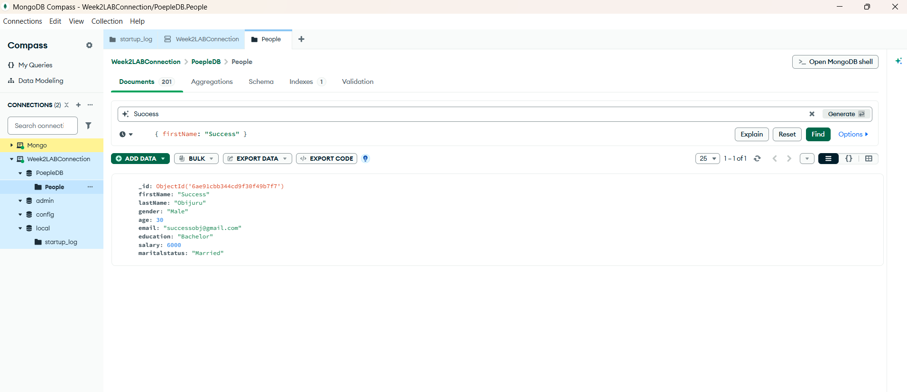
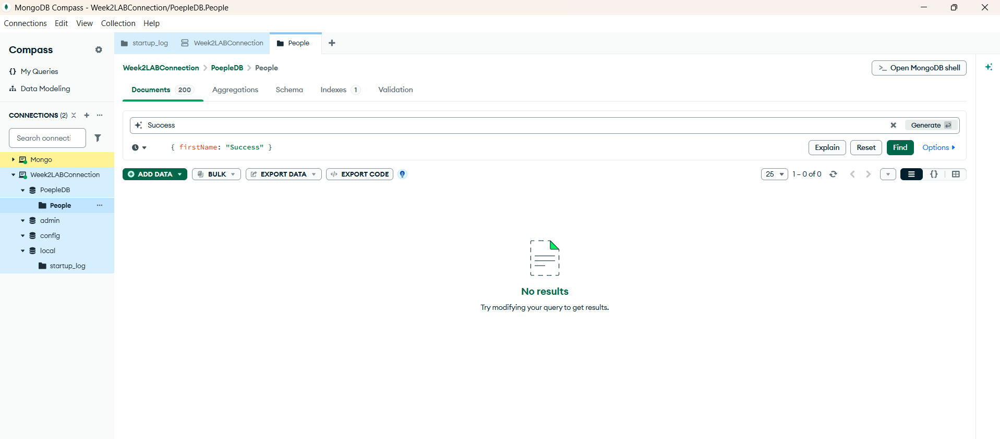
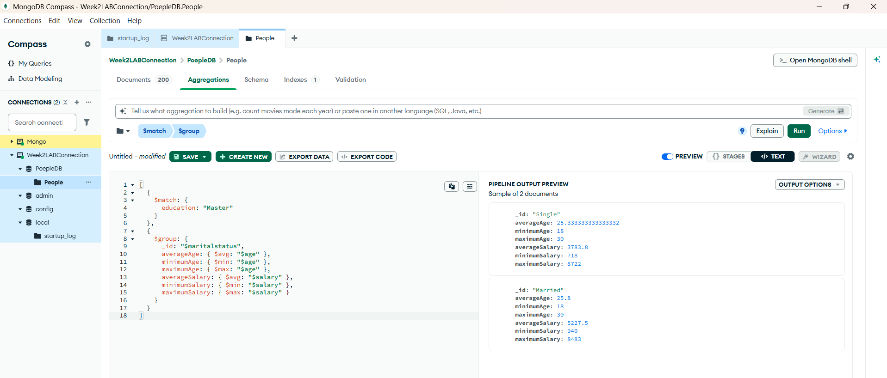
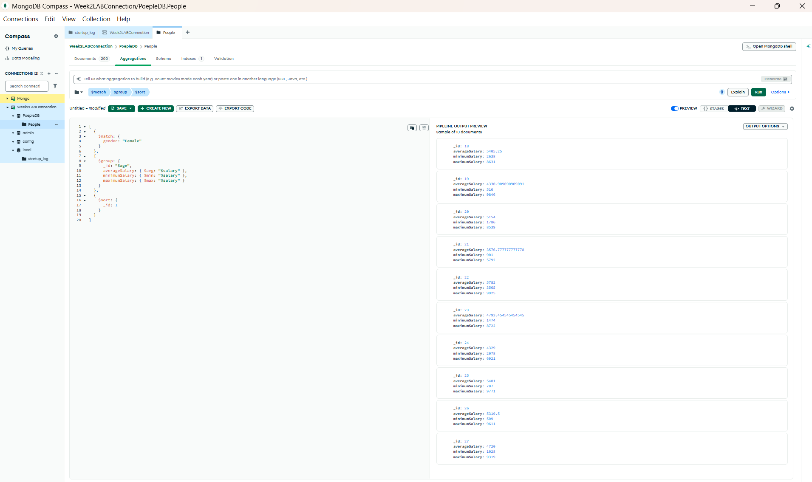
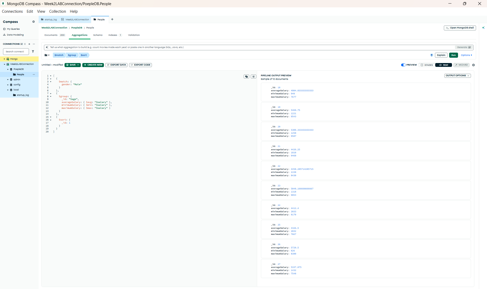
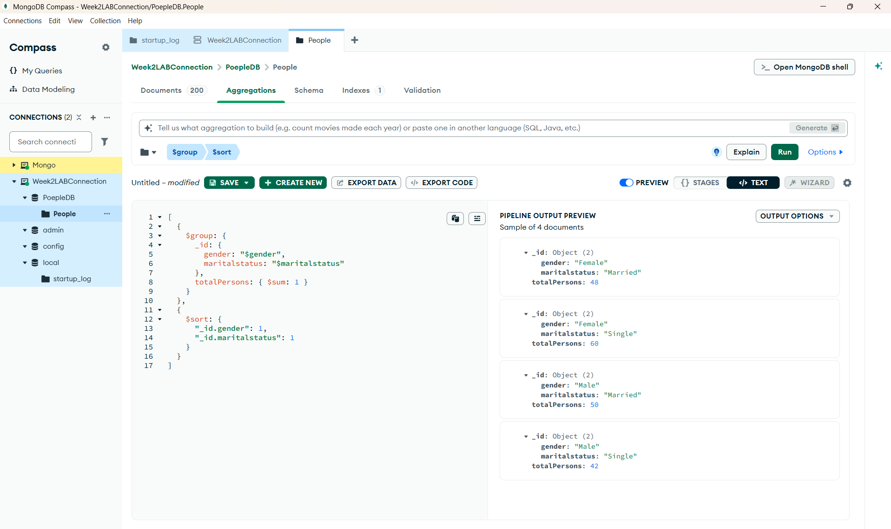

# CN5006 Web and Mobile Application Development Portfolio

**Student Name:** Chibuike Success Obijuru

## Week 1 - Introduction to JavaScript and Node.js

### Lab Activities

During the Week 1 lab, I completed a series of introductory JavaScript exercises using Visual Studio Code and Node.js. I created and executed my first JavaScript program using `console.log()`, performed addition using variables, and installed and used the `prompt-sync` package to accept user input. I also used `if`, `else if`, and `else` statements to determine whether a number entered by the user was positive, negative, or zero.

Evidence of the completed exercises is provided in the Week 1 screenshots.

### Portfolio Exercise

For the Week 1 portfolio exercise, I developed an interactive JavaScript program that accepts two numbers from the user and performs four arithmetic operations: addition, subtraction, multiplication, and division.

The program was successfully executed using Node.js and produced the expected results for the test values 10 and 5.

Evidence:,,,
### Reflection

During Week 1, I learned how to create and run basic JavaScript programs using Visual Studio Code and Node.js. I started by checking that Node.js was installed correctly and then created an `index.js` file. My first exercise used `console.log()` to display simple messages in the terminal. I then progressed to using variables and arithmetic operators to add two numbers.

I also learned how to use the `prompt-sync` package to accept input from a user. Using `if`, `else if`, and `else` statements, I created a program that determined whether an entered number was positive, negative, or zero. This helped me understand how conditional statements control the flow of a JavaScript program.

For the portfolio exercise, I created an interactive arithmetic program that accepts two numbers from the user and performs addition, subtraction, multiplication, and division. This allowed me to apply variables, user input, arithmetic operators, and terminal output within one program.

One challenge I encountered was understanding how external packages such as `prompt-sync` are used in a Node.js program. I learned that the package first needs to be installed using npm before it can be imported with `require()`. I also learned the importance of working in the correct directory before running `node index.js`.

Overall, Week 1 improved my understanding of the basic JavaScript and Node.js development process. My main learning point was that a program can take user input, process it using variables, operators and conditional logic, and then display the result to the user.

---

## Week 2

### Lab Activities
During Week 2, I worked with MongoDB Compass to develop my understanding of NoSQL databases and how data can be stored, queried and analysed using MongoDB.

I connected to MongoDB using Week2LABConnection and worked with the PeopleDB database and People collection. The collection contained 200 documents with fields including first name, last name, gender, age, email, education, salary and marital status.

The screenshot below shows the PeopleDB database and the 200 documents contained in the People collection.

I practised CRUD operations by inserting my own document into the collection. I then used the firstName field to search for the document. This helped me understand the Create and Read operations in MongoDB.

I then edited the document by changing the salary value. This demonstrated the Update operation and showed me how an existing MongoDB document can be modified.

Finally, I deleted the document. After deletion, the collection returned to 200 documents and searching for the record produced no results. This demonstrated the Delete operation and completed my practice of CRUD operations.

#### Update Document

I updated the document that I previously inserted into the People collection. I changed the salary value from 5000 to 6000 using the edit function in MongoDB Compass. This demonstrated how an existing document can be modified without creating a new document.

#### Delete Document

I deleted the document that I had previously inserted and updated in the People collection. After deleting the document, I searched again using the filter `{ firstName: "Success" }` and MongoDB Compass returned no results. The total number of documents also returned from 201 to the original 200 records.

### Portfolio Exercise
I also used MongoDB aggregation pipelines to analyse the data contained in the People collection.

I used $match to filter documents and $group to perform calculations on the filtered records. For example, I filtered records where education was Master and grouped the results according to marital status. I calculated the average, minimum and maximum age and salary for each group.

I also used aggregation to analyse salary according to age. This helped me understand how $group can perform calculations such as $avg, $min and $max, while $sort can organise the resulting age groups
.

I repeated the aggregation process for gender-based analysis, which helped reinforce how $match can select a particular set of documents before the data is passed to $group.
 

Finally, I grouped the whole collection according to both gender and marital status and used $sum to count the number of people in each group. The results showed 48 married females, 60 single females, 50 married males and 42 single males.

These results totalled 200, which matched the total number of documents in the collection. This also helped me verify that my aggregation pipeline was working correctly.

### Reflection
This week's practical work improved my understanding of how MongoDB stores and manages data. I learned that MongoDB stores information as documents within collections rather than using the traditional table and row structure of a relational database.

Practising CRUD operations helped me understand the basic lifecycle of data. By inserting my own document, searching for it, changing its salary and eventually deleting it, I was able to see how Create, Read, Update and Delete operations work in practice.

The aggregation exercises were more challenging at first. I initially had to understand how the different pipeline stages worked together. Through the exercises, I learned that $match filters the documents that should continue through the pipeline, $group groups those documents and performs calculations, and $sort organises the resulting output.

I also encountered some difficulty when working with stages in the MongoDB Compass interface. In particular, changing and adding stages initially caused some confusion about how the stages were being displayed. Working through this helped me understand that an aggregation pipeline is a sequence in which the output of one stage becomes the input for the next stage.

The final gender and marital-status aggregation was particularly useful because I could verify my result mathematically: 48 + 60 + 50 + 42 = 200, which matched the total number of documents in the collection.

Overall, Week 2 gave me practical experience using MongoDB Compass for CRUD operations and data aggregation. I now have a clearer understanding of how MongoDB can be used to store, retrieve, modify and analyse data. This provides a useful foundation for using MongoDB with Node.js later in the module.

---

## Week 3

### Lab Activities

### Portfolio Exercise

### Reflection

---

## Week 4

### Lab Activities

### Portfolio Exercise

### Reflection
